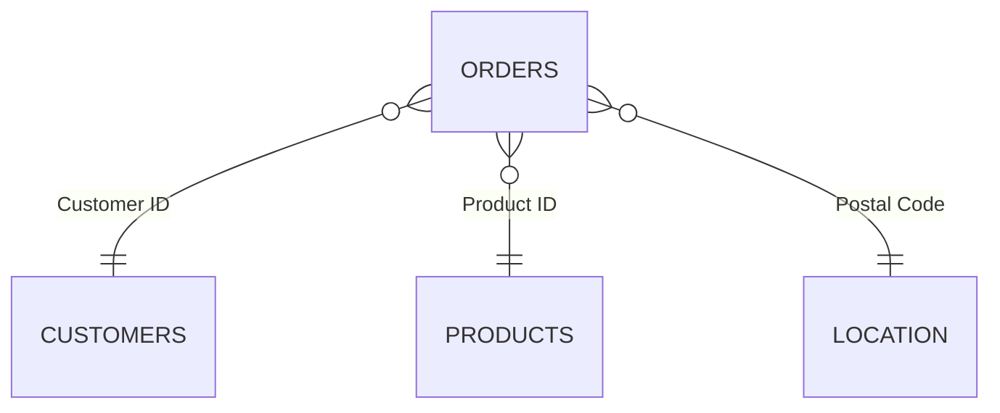

# Sales Storytelling with Tableau

An interactive two-dashboard Tableau story that turns four years of retail order data (2020–2023) into a clear answer to two questions: **how is the business performing, and who is driving it?**

Pick a year, and every KPI, trend and ranking recalculates against the prior year, so the same dashboards tell the story for any year in the data.

### 👉 [View the live, interactive dashboards on Tableau Public](https://public.tableau.com/app/profile/divakar.santhakumar/viz/SalesCustomerDashboards_17921026474300/CustomerDashboard)

[](https://public.tableau.com/app/profile/divakar.santhakumar/viz/SalesCustomerDashboards_17921026474300/CustomerDashboard)

---

## Dashboards

### 1. Sales Dashboard
Where is revenue and profit coming from, and how does it compare with last year?

- **KPI cards** for Total Sales, Total Profit and Total Quantity, each with a **% change vs. prior year** and a sparkline. The highest month is marked with a blue dot and the lowest with an orange dot.
- **Sales & Profit by Sub-Category**: current-year sales (black bar) against prior-year sales (grey bar), next to profit. Losses show in orange.
- **Sales & Profit Trends over Time**: weekly step charts with an average reference line. The line is blue above average and orange below.

### 2. Customer Dashboard
Who is buying, how often, and who are the most valuable customers?

- **KPI cards** for Total Customers, Sales per Customer and Total Orders, each with a % change vs. prior year and a sparkline.
- **Customer Distribution by Number of Orders**: a histogram showing how many customers placed 1, 2, 3 or more orders in the year.
- **Top 10 Customers by Profit**: rank, last order date, profit, sales and order count.

[](https://public.tableau.com/app/profile/divakar.santhakumar/viz/SalesCustomerDashboards_17921026474300/CustomerDashboard)

### Interactivity
- A **Select Year** parameter (default 2023) switches the whole story between years.
- **Icon navigation** moves between the Sales and Customer dashboards.
- A **show/hide filter panel** toggle keeps the layout clean.

---

## Key insights (2023 view)

| Metric | 2023 | vs. 2022 |
|---|---|---|
| Sales | $733K | +20.4% |
| Profit | $93K | +12.5% |
| Quantity | 12.5K units | +26.8% |
| Customers | 693 | +8.6% |
| Sales per customer | $1,058 | +10.8% |
| Orders | 1,687 | +28.3% |

- **Steady growth.** Annual sales rose from **$484K (2020)** to **$733K (2023)**, and profit from **$50K** to **$93K**.
- **Growth came from more orders, not just more customers.** Orders grew 28.3% year over year, while the customer count grew 8.6%.
- **Technology and Office Supplies carry the profit.** In 2023, Technology earned about 18.7% margin and Office Supplies 16.1%. Furniture earned about 1.4%, on $215K of sales.
- **Tables is a drag.** It brought in about $61K of sales in 2023 and lost about $8.1K. Machines swung from profit in 2022 to a loss in 2023, and Bookcases and Supplies were also unprofitable.
- **Discounts hurt.** Order lines discounted by more than 30% make up 12% of all lines and lost about $125K in total profit.
- **Regional gap.** In 2023 the West ($250K sales, $43.8K profit) and East ($212K, $33.0K) outperform the Central region ($147K sales, only $7.6K profit).
- **Most customers are occasional buyers.** In 2023, 400 of 693 customers placed just one or two orders. Only 13 placed six or more.

---

## Data

Four CSV files in [`Datasets/`](Datasets/), modelled as a star around the orders table:

| File | Rows | Contents |
|---|---|---|
| `Orders.csv` | 9,994 | One row per order line (5,009 orders, Jan 2020 – Dec 2023): dates, ship mode, segment, sales, quantity, discount, profit |
| `Customers.csv` | 793 | Customer ID and name |
| `Products.csv` | 1,894 | Product ID, category (3), sub-category (17), product name |
| `Location.csv` | 632 | Postal code, city, state (49), region (4), country |



> The files are **semicolon-delimited** with a **comma as the decimal separator**, `dd/mm/yyyy` dates and Windows-1252 encoding. For Python: `pd.read_csv(path, sep=";", decimal=",", encoding="latin-1")`.

Full column descriptions and known data-quality notes are in the [data dictionary](docs/data-dictionary.md).

---

## Tableau techniques used

- **Tableau relationships** (logical layer) joining orders to customers, products and locations without flattening the data.
- **Parameter-driven year selection** with calculated fields for current year (CY) vs. prior year (PY) and **% difference** logic.
- **LOD expressions** for per-customer order counts, used in the customer-frequency histogram.
- **Sparkline KPI cards** with highest and lowest month highlights.
- **Dual-comparison bars** (current vs. prior year) with profit and loss colour coding.
- **Reference lines** with above/below-average colouring on the weekly trends.
- **Dashboard actions** and **image-based navigation buttons** in place of default tabs, with a collapsible filter panel.
- **Custom layout containers and icon assets** for a consistent look.

---

## Repository structure

```
.
├── Datasets/        # Orders, Customers, Products, Location (CSV)
├── Workbook/        # Sales & Customer Dashboards.twbx  (packaged Tableau workbook)
├── Screenshots/     # Dashboard previews used in this README
├── images/          # Icons used in the workbook (logo, navigation, filter toggle)
└── docs/            # data-dictionary.md
```

---

## How to open the workbook

**Easiest:** open the [live version on Tableau Public](https://public.tableau.com/app/profile/divakar.santhakumar/viz/SalesCustomerDashboards_17921026474300/CustomerDashboard). No install needed. Use the icons at the top right to switch between the Sales and Customer dashboards.

**To explore the workbook itself:**

1. Install **Tableau Desktop** or the free **Tableau Public** desktop app.
2. Open [`Workbook/Sales & Customer Dashboards.twbx`](Workbook/).
3. If Tableau reports missing data sources, choose **Edit Data Source** and point each connection to the matching file in [`Datasets/`](Datasets/). The workbook was originally built against a local folder, so the paths may need updating.
4. Use the **Select Year** parameter to change the comparison year.

---

## Author

**Divakar** · [GitHub @divakars1109](https://github.com/divakars1109)
